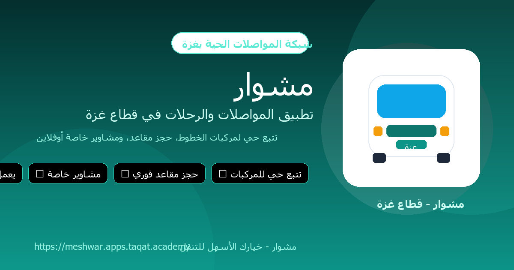

<p align="center">
  
</p>

<h1 align="center">مشوار | Mishwar</h1>

<p align="center">
  <strong>شبكة المواصلات الحية والرحلات الخاصة في قطاع غزة | Gaza Offline-First Live Transit & Private Charter PWA</strong>
</p>

<p align="center">
  <a href="https://github.com/NabilDawud/meshwar/actions/workflows/ci-cd.yml"></a>
  <a href="https://meshwar.apps.taqat.academy"></a>
  
  
  
  
</p>

---

## 🌐 Live Application

- **Production URL:** [https://meshwar.apps.taqat.academy](https://meshwar.apps.taqat.academy)
- **Status Endpoint:** `GET /api/health`
- **PWA Manifest:** Supported on mobile Safari & Chrome for full-screen home-screen installation.

---

## 📖 About Mishwar (عن مشوار)

**مشوار (Mishwar)** is an offline-first, high-resilience transit network and private trip charter application designed specifically for the unique infrastructure realities of the **Gaza Strip**. 

Built to handle unstable power, low bandwidth (2G/EDGE), network outages, and mobile SIM swapping, Mishwar empowers riders and drivers to navigate core arterial corridors (طريق صلاح الدين وشارع الرشيد الساحلي) with certainty, privacy, and zero data waste.

---

## 🌟 Key Capabilities

### 1. 🧭 Offline-First Trip Planner (المخطط بدون إنترنت)
- Computes multi-leg transit itineraries locally on the device using an in-memory graph of verified Gaza landmarks and intersections.
- Zero server queries required once cached: works seamlessly during complete internet blackouts.

### 2. 🗺️ Live Corridor Transit & Active Vehicles
- Real-time map pins and status tracking for transit vehicles running daily corridors (Salah al-Din, Al-Rashid Coastal Road).
- Displays last-known GPS coordinates with explicit age indicators (e.g. *"آخر موقع: دوار الكويت، منذ 3 دقائق"*), avoiding algorithmic hallucinations or speculative arrival times.

### 3. 🚕 Special Requests & Direct Messaging (مشاوير خاصة ومراسلة)
- Custom point-to-point charter requests across governorates (Rafah, Khan Yunis, Deir al-Balah, Gaza City, North Gaza).
- Drivers submit binding quotes in shekels (₪ / ILS) with direct chat negotiations and instant offer acceptance.

### 4. 🔒 Privacy-Gated Communication & Tap-to-Call
- **Strict Privacy Rule:** Rider phone numbers remain completely hidden until a booking is confirmed or an offer is accepted.
- Instant `tel:` dialer integration for rapid coordination in low-signal environments.

### 5. 🛡️ Gaza-Adaptive Profile Security
- **SIM Resiliency:** Allows up to 3 phone number modifications per rolling 24-hour window (accommodating Jawwal 059 / Ooredoo 056 swaps and typo corrections).
- **In-Ride Lock:** Changes to identity or phone number are strictly prohibited while an active ride or booking is underway.

### 6. 🚗 Diverse Vehicle Types & Trailers ('Ajala)
- Strict 1:1 relationship between Driver and Vehicle.
- Supports cars, microbuses, and **'Ajala (عجلة)** (passenger trailers/carts towed by vehicles) with mandatory exterior street photos so riders recognize their vehicle on the street.

---

## 🛠️ Technology Stack

| Layer | Technology |
| :--- | :--- |
| **Backend Framework** | Laravel 13 running on **PHP 8.4** |
| **Web Server / Runtime** | **FrankenPHP** (Caddy-powered, worker mode enabled) |
| **Database** | MySQL 9.7 (Production) / SQLite in-memory (Tests) |
| **Frontend & UI** | Blade + Tailwind CSS (RTL logical properties: `ms-*`, `me-*`) + Alpine.js |
| **Maps & Geospatial** | MapLibre GL JS + Arabic bidirectional text plugin (`@mapbox/mapbox-gl-rtl-text`) |
| **Authentication** | Headless Fortify + Google OAuth (Laravel Socialite) |
| **Continuous Integration** | GitHub Actions (Pint style audit, Vite build, PHPUnit 82 test suite) |
| **Continuous Deployment** | Dokku deployment automation |

---

## 🚀 Quickstart for Developers

### 1. Prerequisites
- PHP 8.4+
- Composer 2+
- Node.js 24+ & npm

### 2. Setup
```bash
# Clone the repository
git clone https://github.com/NabilDawud/meshwar.git
cd meshwar

# Install dependencies
composer install
npm install

# Setup environment
cp .env.example .env
php artisan key:generate

# Run database migrations
php artisan migrate

# Build frontend assets
npm run build
```

### 3. Running Automated Tests
Mishwar adheres strictly to **Test-Driven Development (TDD)** and evidence-based verification:

```bash
# Run the entire test suite (82 feature & unit tests)
php artisan test --compact

# Check code formatting with Laravel Pint
vendor/bin/pint --test
```

---

## 📄 License
This project is open-source software licensed under the [MIT License](LICENSE).
